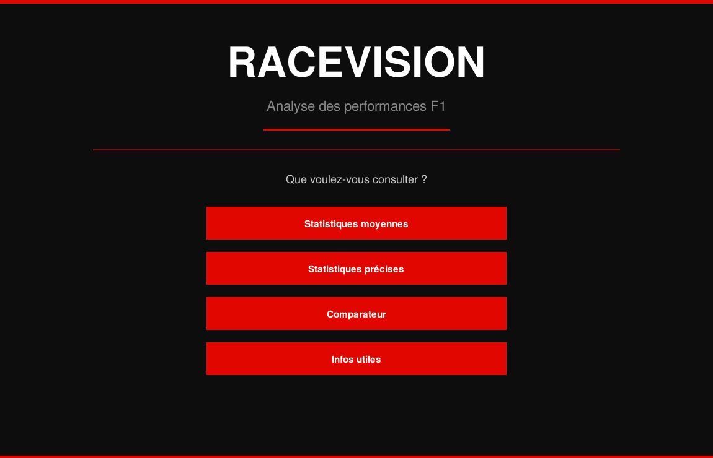
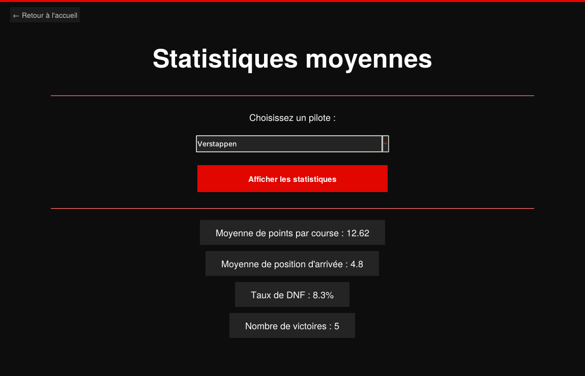
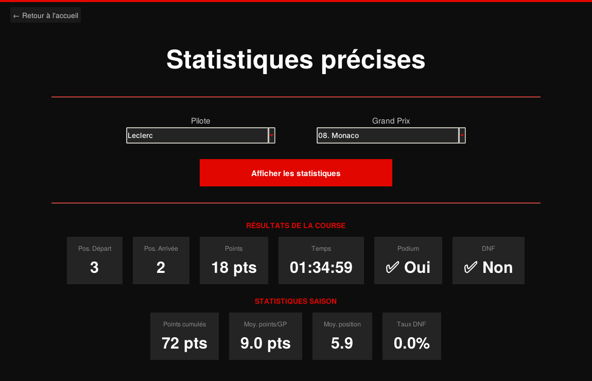
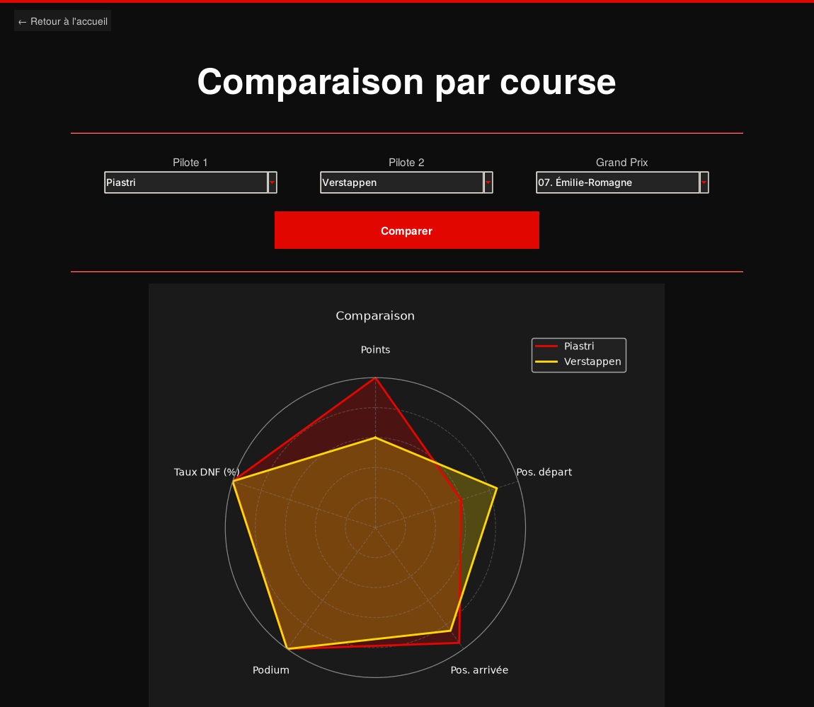
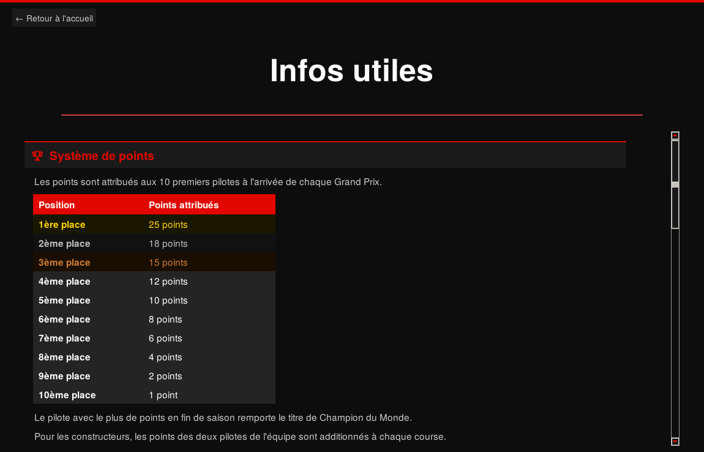

# 🏎️ RaceVision — Analyse des performances F1

Application de bureau en **Python** pour explorer et comparer les performances des pilotes sur la saison **2025 de Formule 1** : statistiques par pilote, résultats course par course, comparaison visuelle sur graphique radar et page d'explication des règles.

Projet réalisé en **Bachelor 1 à l'IPSA** (cours de Python), en binôme.



---

## 🎯 Le problème

Les résultats de F1 représentent une grande quantité de données dispersées, peu synthétisées et sans outil de comparaison simple. Pour quelqu'un qui ne suit pas la F1 de près, il est difficile de comprendre les enjeux de chaque course.

**RaceVision** centralise ces données dans une interface claire et propose une analyse statistique visuelle.

## ✨ Fonctionnalités

| Page | Ce qu'elle fait |
|---|---|
| **Statistiques moyennes** | Moyenne de points par course, position moyenne d'arrivée, taux d'abandon (DNF) et nombre de victoires d'un pilote sur la saison |
| **Statistiques précises** | Résultat détaillé d'un pilote sur un Grand Prix : position de départ / d'arrivée, points, temps, podium, DNF + son bilan cumulé à ce stade de la saison |
| **Comparateur** | Graphique radar (matplotlib) comparant deux pilotes sur une même course, avec normalisation des indicateurs |
| **Infos utiles** | Système de points, règles, drapeaux, Safety Car et pneus Pirelli expliqués simplement |

## 📸 Captures d'écran

| Statistiques moyennes | Statistiques précises |
|---|---|
|  |  |

| Comparateur (graphique radar) | Infos utiles |
|---|---|
|  |  |

## 🛠️ Technologies

- **Python 3**
- **Tkinter / ttk** — interface graphique multi-fenêtres avec thème sombre personnalisé (couleurs F1)
- **Matplotlib** — graphique radar intégré dans Tkinter (`FigureCanvasTkAgg`)
- **NumPy** — calcul des angles du radar
- **CSV** — lecture et parsing manuel du fichier de données (sans pandas)

## 📊 Les données

`F1_2025_Data_Ultimate.csv` contient **~500 lignes** (24 Grands Prix × 21 pilotes) et 16 colonnes :
Grand Prix, pilote, écurie, nationalité, position de départ et d'arrivée, points, podium, DNF, temps, ainsi que des statistiques cumulées (points, podiums, DNF, moyennes, taux de DNF).

Ce jeu de données a été construit pour le projet sur la structure de la saison 2025 (calendrier, pilotes et écuries).

## 🚀 Lancer l'application

```bash
git clone https://github.com/timothebardoux-bit/RaceVision.git
cd RaceVision
pip install -r requirements.txt
python racevision.py
```

> Le fichier CSV doit se trouver dans le même dossier que `racevision.py` (lancer la commande depuis ce dossier).
> Tkinter est inclus avec Python sur Windows et macOS. Sous Linux : `sudo apt install python3-tk`.

## 🧠 Ce que j'ai appris

- Structurer une application graphique en plusieurs pages avec Tkinter
- Lire et exploiter un fichier de données sans bibliothèque externe
- Calculer et normaliser des indicateurs pour les comparer sur un même graphique (inversion des positions et du taux de DNF : plus petit = meilleur)
- Soigner l'expérience utilisateur : thème cohérent, navigation simple, informations pédagogiques

## 👤 Contact

**Timothé Bardoux** — étudiant ingénieur à l'IPSA · [Mon profil GitHub](https://github.com/timothebardoux-bit)
